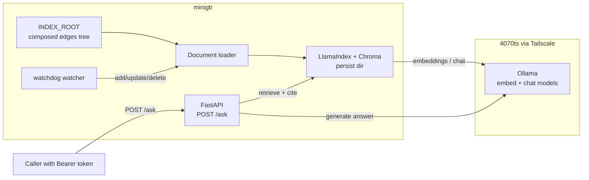

# Edges RAG Design Spec

**Date:** 2026-10-28  
**Repo:** VirusPC/edges-rag (public)  
**Status:** Locked

## Problem

The Edges **framework** official site needs a knowledge Q&A agent that answers questions from the composed VirusPC/edges tree, with citations back to source files. Operators run this on **minigtr**, talking to an Ollama instance on **4070ts** over Tailscale. There is no public OpenAI-compatible surface and no personal brain/workspace dump in scope.

## Goals

1. Index text source files under a configurable `INDEX_ROOT` (typically a composed edges tree such as `.harness/compose/edges`).
2. Full re-index on process startup, then realtime incremental add/update/delete via a file watcher.
3. Persist embeddings in local Chroma on disk.
4. Expose a single authenticated FastAPI endpoint `POST /ask` that returns an answer plus path/snippet/score citations.
5. Use Ollama (chat + embeddings) reached via `OLLAMA_BASE_URL` (Tailscale hostname or IP); never hardcode secrets or host credentials.
6. Ship as a Python package with clear local/run instructions; optional containerization later.

## Non-Goals

- Personal brain / private workspace RAG (edges-brain, user memory dumps).
- MySQL or any external relational store.
- OpenAI-compatible API surface in v1.
- Multi-tenant auth, OAuth, or per-user quotas.
- UI / official-site frontend (this service is the backend Q&A agent only).
- Hybrid/keyword search beyond what LlamaIndex + Chroma retrieval provides in v1.
- Automatic model pulls or Ollama management on 4070ts.

## Architecture



**Runtime flow**

1. On startup: load settings from env → walk `INDEX_ROOT` with allow/deny lists → embed via Ollama → upsert into Chroma → start watchdog.
2. On file change: upsert or delete by source path metadata → Chroma stays in sync.
3. On `POST /ask`: validate Bearer token → retrieve top-k → chat completion with retrieved context → return `{ answer, citations }`.

## Config

All settings come from environment variables (and optional `.env`). Use pydantic-settings.

| Variable | Required | Default / example | Purpose |
|----------|----------|-------------------|---------|
| `EDGES_ROOT` | no | unset | Optional alias / documentation hint for the composed edges root |
| `INDEX_ROOT` | yes | e.g. `/path/to/.harness/compose/edges` | Directory to scan and watch |
| `CHROMA_PERSIST_DIR` | yes | e.g. `./data/chroma` | Chroma on-disk persist path |
| `OLLAMA_BASE_URL` | yes | e.g. `http://4070ts-win11:11434` | Ollama base URL over Tailscale |
| `OLLAMA_EMBED_MODEL` | yes | e.g. `nomic-embed-text` | Embedding model name |
| `OLLAMA_CHAT_MODEL` | yes | e.g. `llama3.2` | Chat model name |
| `RAG_API_TOKEN` | yes | (secret) | Bearer token for `/ask` |
| `RAG_TOP_K` | no | `5` | Retrieval top-k |
| `RAG_HOST` | no | `0.0.0.0` | uvicorn bind host |
| `RAG_PORT` | no | `8000` | uvicorn bind port |
| `INDEX_ALLOW_EXTENSIONS` | no | `.md,.txt,.py,.ts,.tsx,.js,.jsx,.json,.yaml,.yml,.toml,.sh,.rs,.go` | Comma-separated allowlist |
| `INDEX_EXCLUDE_DIRS` | no | `node_modules,.git,__pycache__,.venv,dist,build` | Comma-separated directory names to skip |

Binary files are never indexed (extension allowlist + skip non-text / undecodable content).

## API Contract

### `POST /ask`

**Headers**

```
Authorization: Bearer <RAG_API_TOKEN>
Content-Type: application/json
```

**Request body**

```json
{
  "question": "How does edges compose add a harness repo?"
}
```

**Success `200`**

```json
{
  "answer": "edges compose add mounts an external harness repo into the current scope via …",
  "citations": [
    {
      "path": "skills/edges-compose/SKILL.md",
      "snippet": "edges compose add mounts an external harness…",
      "score": 0.82
    }
  ]
}
```

- `path` is relative to `INDEX_ROOT` when possible; otherwise absolute path under the index root.
- `snippet` is a short excerpt from the retrieved node text (truncated, not the full document).
- `score` is the retriever score when available; use `null` only if the underlying score is absent (prefer always emitting a float when LlamaIndex provides one).

**Auth failure `401`**

```json
{
  "detail": "Unauthorized"
}
```

Missing `Authorization` header, wrong scheme, or wrong token → `401`.

**Validation failure `422`**

Empty or missing `question` → FastAPI/Pydantic validation error.

### Optional: `GET /health`

Not required for v1. Add only if trivial (`{"status":"ok"}`) and does not require auth. Prefer omitting until needed (YAGNI).

## Security Notes

- **Bearer-only auth** in v1: compare `Authorization: Bearer …` to `RAG_API_TOKEN` with a constant-time comparison.
- Never log the token or put it in the repo; ship `.env.example` with a placeholder only.
- Bind intentionally: default `0.0.0.0` is for LAN/Tailscale deploy on minigtr; operators may set `127.0.0.1` for local-only.
- Index only the configured tree; do not follow symlinks outside `INDEX_ROOT` (resolve and reject paths that escape the root).
- Public GitHub repo must contain no secrets, no production tokens, no private workspace dumps.
- Ollama is assumed reachable only on the Tailscale network; do not expose Ollama publicly as part of this design.

## Deployment Sketch

**Primary (v1):** run on minigtr with Python 3.11+ venv:

```bash
export INDEX_ROOT=/path/to/.harness/compose/edges
export CHROMA_PERSIST_DIR=/var/lib/edges-rag/chroma
export OLLAMA_BASE_URL=http://4070ts-win11:11434
export OLLAMA_EMBED_MODEL=nomic-embed-text
export OLLAMA_CHAT_MODEL=llama3.2
export RAG_API_TOKEN=…   # from secret store
uvicorn edges_rag.app:app --host 0.0.0.0 --port 8000
```

**Optional later (YAGNI for early tasks):** `Dockerfile` and/or `docker-compose.yml` mounting `INDEX_ROOT` and `CHROMA_PERSIST_DIR`, plus a simple systemd unit or run script. Document in README; implement only in a late optional task if time remains.

## Stack

- Python 3.11+
- LlamaIndex (core + Ollama integrations)
- FastAPI + uvicorn
- chromadb (local persist)
- watchdog (filesystem events)
- pydantic-settings
- httpx via LlamaIndex Ollama client path
- pytest for unit/integration tests with mocked Ollama and temp Chroma

## Testing Strategy (design-level)

- Unit tests for config parsing, path allow/deny, loader document metadata.
- Indexer tests with a temp directory of fixture files (no live Ollama): mock embedding model.
- Watchdog/incremental tests: create/update/delete files under a temp root and assert store membership by path.
- API tests: TestClient happy path for `/ask` and `401` for bad/missing token; mock query engine / Ollama.

## Open Decisions (explicitly deferred)

- Exact snippet length / citation formatting polish.
- Whether to expose `GET /health` (default: no).
- Production process supervisor (systemd vs docker) — README covers both lightly; pick at deploy time.
